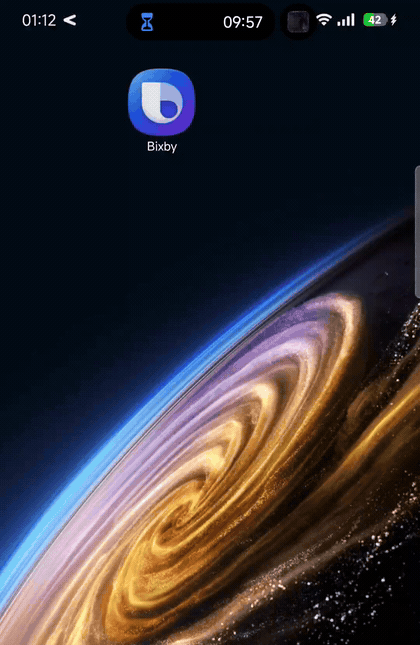
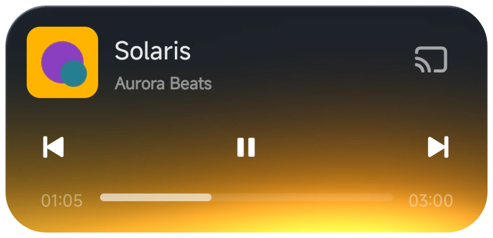
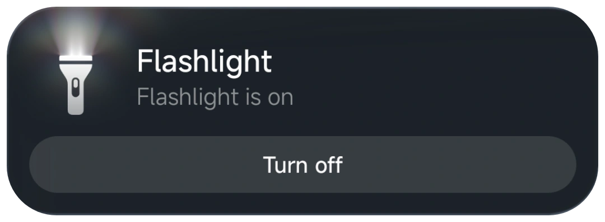
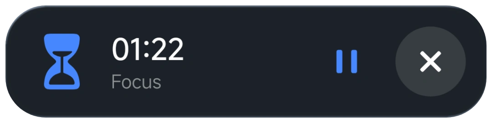
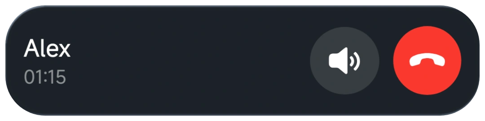
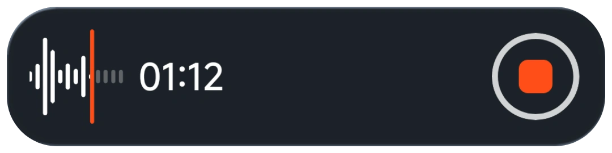
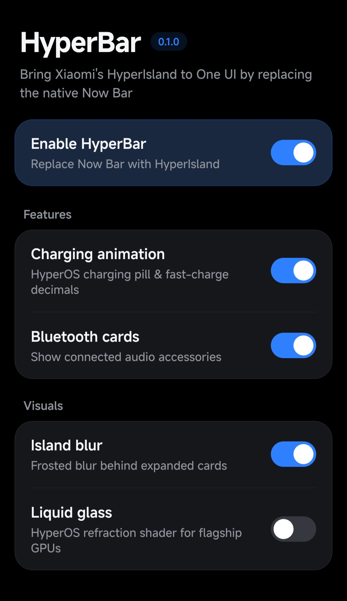

# HyperBar

Bring Xiaomi's HyperIsland to One UI by replacing the native Now Bar.

HyperBar is an LSPosed module for Samsung One UI (Android 15/16) that replaces the native Now Bar and plug-in charging indicator with interactive HyperIsland capsules and expanded live cards.

## Showcase & Previews

<p align="center">
  
</p>

| Media Player | Fast Charging |
| :---: | :---: |
|  |  |

| Flashlight | Timer |
| :---: | :---: |
|  |  |

| Ongoing Call | Recording |
| :---: | :---: |
|  |  |

## Features

- **Interactive Live Capsules & Shade Cards**: Displays live activities in the status bar and expanded cards in the notification panel for media playback, timers, stopwatch, flashlight, ongoing calls, screen & voice recording, Bluetooth devices, and navigation.
- **HyperOS Charging Capsule**: Replaces One UI's unlocked plug-in charging animation with a glowing charging capsule featuring real-time decimal battery readouts during fast charging (with clean percentage fallback where high-precision telemetry is unavailable).
- **Multi-Activity Coexistence & Gestures**: Seamlessly handles multiple concurrent activities—swipe horizontally to cycle between active capsules, tap to expand or open the app, and enjoy fluid spring transitions.
- **Adaptive Blur & Liquid Glass**: Uses native compositor blur where supported with an automatic fallback for mid-range One UI devices, plus an optional liquid glass refraction effect.
- **Companion Settings App**: Configure HyperBar directly from the launcher with toggles for the main module, charging animation, Bluetooth cards, island blur, and liquid glass.

## Requirements & Setup

1. A Samsung device running **One UI** on **Android 15 or 16** with **LSPosed** installed.
2. Install the HyperBar APK and enable it in LSPosed Manager.
3. Select **SystemUI** and **Samsung Clock** in the module scope.
4. Reboot your device.

> [!NOTE]
> Incoming call notifications continue to use One UI's native call interface. Once a call is answered, HyperBar displays the active ongoing call capsule and card.

## Companion App

<p align="center">
  
</p>

| Option | Description |
| --- | --- |
| **Enable HyperBar** | Master switch to enable or disable the island overlay. |
| **Charging animation** | Show the HyperOS charging capsule when plugging in while unlocked. |
| **Bluetooth cards** | Display connection cards for paired Bluetooth audio devices. |
| **Island blur** | Enable frosted background blur behind expanded cards. |
| **Liquid glass** | Opt-in refractive glass edge effect on supported devices. |

## Development

To run the native Rust unit tests:

```sh
cargo test --locked --manifest-path native/Cargo.toml
```

To verify Java source compilation (requires Python 3, JDK, `aapt2`, and an Android API 35+ `android.jar`):

```sh
export HYPERBAR_ANDROID_JAR=/path/to/android.jar
python3 tools/check_source.py
```
